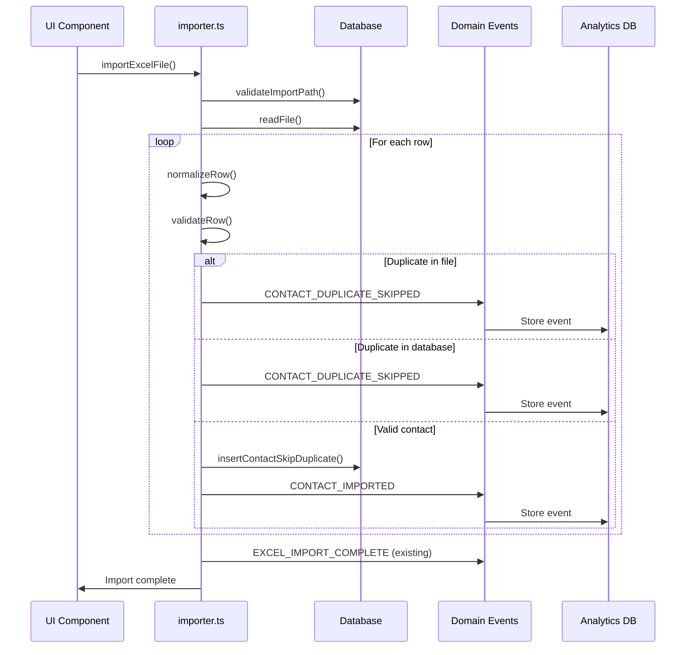
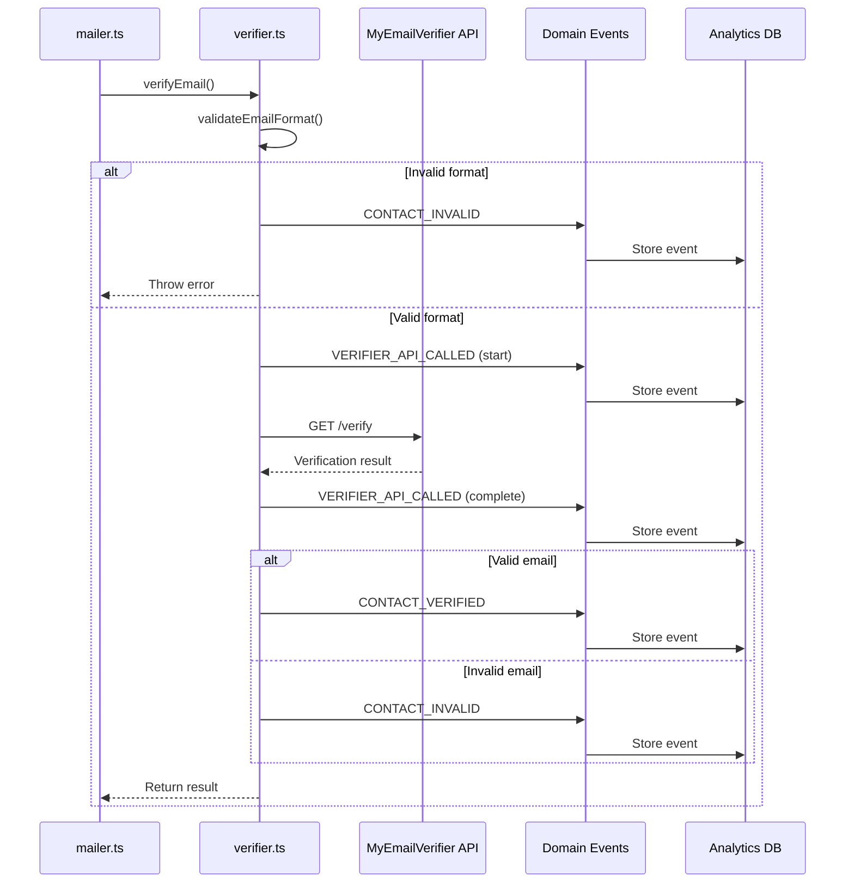
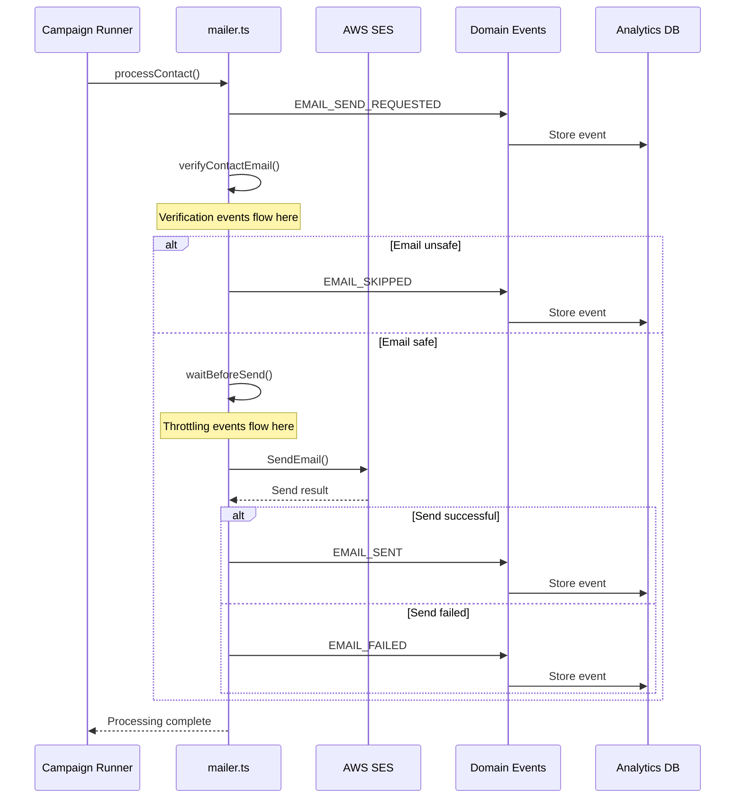

# Phase 2 - Event-Driven Architecture and Analytics Schema Design

## Executive Summary

This document presents a minimal, event-driven architecture design for the TermiSend email outreach tool. The design extends the existing event system with typed domain events, adds analytics tables for meaningful metrics, and defines integration points throughout the codebase.

## 1. Internal Event System Design

### 1.1 Event Emitter Architecture

The design extends the existing [`AnalyticsEventEmitter`](src/ses-analytics.ts:70) class to support domain events while maintaining simplicity and avoiding global side effects.

```typescript
// src/events/domain-event-emitter.ts

/**
 * Domain event types for TermiSend
 * Covers all real business events identified in Phase 1 analysis
 */
export type DomainEventType = 
  // Contact lifecycle events
  | 'CONTACT_IMPORTED'
  | 'CONTACT_DUPLICATE_SKIPPED'
  | 'CONTACT_VERIFIED'
  | 'CONTACT_INVALID'
  | 'CONTACT_DEEMED_UNSAFE'
  
  // Email sending events
  | 'EMAIL_SEND_REQUESTED'
  | 'EMAIL_SENT'
  | 'EMAIL_FAILED'
  | 'EMAIL_SKIPPED'
  
  // API events
  | 'SES_API_CALLED'
  | 'VERIFIER_API_CALLED'
  
  // Quota and throttling events
  | 'QUOTA_SNAPSHOT_RECORDED'
  | 'QUOTA_CHECK_PASSED'
  | 'QUOTA_CHECK_FAILED'
  | 'THROTTLE_DELAY_STARTED'
  | 'THROTTLE_DELAY_COMPLETED'
  
  // Campaign events
  | 'CAMPAIGN_STARTED'
  | 'CAMPAIGN_COMPLETED'
  | 'CAMPAIGN_PAUSED';

/**
 * Base interface for all domain events
 * Ensures consistent structure across all event types
 */
export interface DomainEvent {
  /** Type of event */
  type: DomainEventType;
  /** Unique identifier for event correlation */
  eventId: string;
  /** Timestamp when event occurred */
  timestamp: Date;
  /** Optional correlation ID for event chains */
  correlationId?: string;
  /** Event-specific payload */
  payload: DomainEventPayload;
}

/**
 * Union type for all event payloads
 * Each event type has its own specific payload interface
 */
export type DomainEventPayload = 
  | ContactImportedPayload
  | ContactDuplicateSkippedPayload
  | ContactVerifiedPayload
  | ContactInvalidPayload
  | ContactDeemedUnsafePayload
  | EmailSendRequestedPayload
  | EmailSentPayload
  | EmailFailedPayload
  | EmailSkippedPayload
  | SesApiCalledPayload
  | VerifierApiCalledPayload
  | QuotaSnapshotRecordedPayload
  | QuotaCheckPassedPayload
  | QuotaCheckFailedPayload
  | ThrottleDelayStartedPayload
  | ThrottleDelayCompletedPayload
  | CampaignStartedPayload
  | CampaignCompletedPayload
  | CampaignPausedPayload;

/**
 * Domain event emitter
 * Simple, typed event system without external dependencies
 */
export class DomainEventEmitter {
  private handlers: Map<DomainEventType, DomainEventHandler[]> = new Map();
  private static instance: DomainEventEmitter;

  /**
   * Get singleton instance
   * Ensures single event emitter across the application
   */
  static getInstance(): DomainEventEmitter {
    if (!DomainEventEmitter.instance) {
      DomainEventEmitter.instance = new DomainEventEmitter();
    }
    return DomainEventEmitter.instance;
  }

  /**
   * Emit a domain event
   * @param event - Domain event to emit
   */
  emit(event: DomainEvent): void {
    const handlers = this.handlers.get(event.type);
    if (handlers) {
      for (const handler of handlers) {
        try {
          handler(event);
        } catch (error) {
          // Silently ignore handler errors to prevent disrupting main flow
          console.error(`Domain event handler error for ${event.type}:`, error);
        }
      }
    }

    // Persist to analytics database asynchronously
    this.persistEvent(event).catch((error) => {
      console.error(`Failed to persist domain event ${event.type}:`, error);
    });
  }

  /**
   * Subscribe to a domain event
   * @param eventType - Event type to subscribe to
   * @param handler - Handler function
   */
  on(eventType: DomainEventType, handler: DomainEventHandler): void {
    if (!this.handlers.has(eventType)) {
      this.handlers.set(eventType, []);
    }
    this.handlers.get(eventType)?.push(handler);
  }

  /**
   * Remove event handler
   * @param eventType - Event type
   * @param handler - Handler function to remove
   */
  off(eventType: DomainEventType, handler: DomainEventHandler): void {
    const handlers = this.handlers.get(eventType);
    if (handlers) {
      const index = handlers.indexOf(handler);
      if (index > -1) {
        handlers.splice(index, 1);
      }
    }
  }

  /**
   * Persist event to analytics database
   * @param event - Domain event to persist
   */
  private async persistEvent(event: DomainEvent): Promise<void> {
    // Implementation will be added in Phase 3
    // This will store events in the analytics_events table
  }
}

/**
 * Event handler function type
 */
export type DomainEventHandler = (event: DomainEvent) => void;

/**
 * Global domain event emitter instance
 * Exported for convenient access throughout the application
 */
export const domainEvents = DomainEventEmitter.getInstance();
```

### 1.2 Event Type Definitions

```typescript
// src/events/event-payloads.ts

// ============================================================================
// Contact Lifecycle Event Payloads
// ============================================================================

export interface ContactImportedPayload {
  /** Contact ID */
  contactId: string;
  /** Email address */
  email: string;
  /** Company name */
  companyName: string;
  /** Person name */
  personName: string;
  /** Source file path */
  sourceFile: string;
  /** Row number in source file */
  rowNumber: number;
}

export interface ContactDuplicateSkippedPayload {
  /** Email that was duplicate */
  email: string;
  /** Source file path */
  sourceFile: string;
  /** Row number in source file */
  rowNumber: number;
  /** Reason for duplicate (database/file) */
  duplicateSource: 'database' | 'file';
}

export interface ContactVerifiedPayload {
  /** Contact ID */
  contactId: string;
  /** Email address */
  email: string;
  /** Verification result */
  result: 'valid' | 'invalid' | 'unknown';
  /** Verification response details */
  details?: {
    isDisposable?: boolean;
    isFree?: boolean;
    domain?: string;
    mxRecord?: boolean;
  };
  /** API response time in milliseconds */
  responseTimeMs?: number;
}

export interface ContactInvalidPayload {
  /** Contact ID */
  contactId: string;
  /** Email address */
  email: string;
  /** Reason for invalid status */
  reason: string;
  /** Validation error details */
  error?: string;
}

export interface ContactDeemedUnsafePayload {
  /** Contact ID */
  contactId: string;
  /** Email address */
  email: string;
  /** Reason for unsafe status */
  reason: string;
  /** Safety check details */
  details?: {
    isDisposable?: boolean;
    isFree?: boolean;
    otherFlags?: string[];
  };
}

// ============================================================================
// Email Sending Event Payloads
// ============================================================================

export interface EmailSendRequestedPayload {
  /** Contact ID */
  contactId: string;
  /** Send log ID */
  sendLogId: string;
  /** Campaign ID (if applicable) */
  campaignId?: string;
  /** Email subject */
  subject: string;
  /** Send mode */
  mode: 'production' | 'test' | 'dry_run';
}

export interface EmailSentPayload {
  /** Contact ID */
  contactId: string;
  /** Send log ID */
  sendLogId: string;
  /** Campaign ID (if applicable) */
  campaignId?: string;
  /** SES message ID */
  messageId: string;
  /** Email subject */
  subject: string;
  /** Send mode */
  mode: 'production' | 'test' | 'dry_run';
  /** Time taken to send in milliseconds */
  sendTimeMs?: number;
}

export interface EmailFailedPayload {
  /** Contact ID */
  contactId: string;
  /** Send log ID */
  sendLogId: string;
  /** Campaign ID (if applicable) */
  campaignId?: string;
  /** Error reason */
  errorReason: string;
  /** Error category */
  errorCategory: 'ses_error' | 'verification_error' | 'throttle_error' | 'other';
  /** Retry attempt number */
  retryAttempt?: number;
}

export interface EmailSkippedPayload {
  /** Contact ID */
  contactId: string;
  /** Send log ID */
  sendLogId: string;
  /** Campaign ID (if applicable) */
  campaignId?: string;
  /** Reason for skipping */
  reason: string;
  /** Skip category */
  skipCategory: 'unsafe_email' | 'dry_run' | 'other';
}

// ============================================================================
// API Event Payloads
// ============================================================================

export interface SesApiCalledPayload {
  /** API endpoint name */
  apiEndpoint: 'SendEmail' | 'GetSendQuota' | 'GetSendStatistics' | 'ListIdentities';
  /** Request duration in milliseconds */
  durationMs: number;
  /** Success status */
  success: boolean;
  /** Error details if failed */
  error?: string;
  /** Request ID from AWS */
  requestId?: string;
}

export interface VerifierApiCalledPayload {
  /** Email being verified */
  email: string;
  /** Request duration in milliseconds */
  durationMs: number;
  /** Success status */
  success: boolean;
  /** Error details if failed */
  error?: string;
  /** Credits remaining after call */
  creditsRemaining?: number;
}

// ============================================================================
// Quota and Throttling Event Payloads
// ============================================================================

export interface QuotaSnapshotRecordedPayload {
  /** Maximum 24-hour send quota */
  max24HourSend: number;
  /** Emails sent in last 24 hours */
  sentLast24Hours: number;
  /** Maximum send rate per second */
  maxSendRate: number;
  /** Source of quota data */
  source: 'api' | 'cached';
  /** Available quota percentage */
  availablePercentage: number;
}

export interface QuotaCheckPassedPayload {
  /** Available quota */
  availableQuota: number;
  /** Required quota for send */
  requiredQuota: number;
  /** Buffer percentage used */
  bufferPercentage: number;
}

export interface QuotaCheckFailedPayload {
  /** Available quota */
  availableQuota: number;
  /** Required quota for send */
  requiredQuota: number;
  /** Reason for failure */
  reason: 'insufficient_quota' | 'rate_limit_exceeded';
}

export interface ThrottleDelayStartedPayload {
  /** Delay duration in milliseconds */
  delayMs: number;
  /** Reason for delay */
  reason: 'rate_limit' | 'random_break';
  /** Contact ID being processed */
  contactId: string;
}

export interface ThrottleDelayCompletedPayload {
  /** Actual delay duration in milliseconds */
  actualDelayMs: number;
  /** Planned delay duration in milliseconds */
  plannedDelayMs: number;
  /** Contact ID that was processed */
  contactId: string;
}

// ============================================================================
// Campaign Event Payloads
// ============================================================================

export interface CampaignStartedPayload {
  /** Campaign ID */
  campaignId?: string;
  /** Total contacts to process */
  totalContacts: number;
  /** Send mode */
  mode: 'production' | 'test' | 'dry_run';
  /** Template file path */
  templatePath: string;
}

export interface CampaignCompletedPayload {
  /** Campaign ID */
  campaignId?: string;
  /** Total contacts processed */
  totalContacts: number;
  /** Successfully sent */
  sentCount: number;
  /** Failed sends */
  failedCount: number;
  /** Skipped sends */
  skippedCount: number;
  /** Campaign duration in milliseconds */
  durationMs: number;
}

export interface CampaignPausedPayload {
  /** Campaign ID */
  campaignId?: string;
  /** Reason for pause */
  reason: 'quota_exhausted' | 'manual' | 'error';
  /** Contacts processed so far */
  processedContacts: number;
  /** Remaining contacts */
  remainingContacts: number;
}
```

## 2. Analytics Database Schema Design

### 2.1 Core Analytics Tables

```sql
-- ============================================================================ 
-- Analytics Event Store
-- ============================================================================ 

CREATE TABLE IF NOT EXISTS analytics_events (
  id UUID PRIMARY KEY DEFAULT gen_random_uuid(),
  event_type VARCHAR(100) NOT NULL,
  event_id VARCHAR(100) NOT NULL UNIQUE,
  correlation_id VARCHAR(100),
  contact_id UUID REFERENCES contacts(id) ON DELETE SET NULL,
  send_log_id UUID REFERENCES send_logs(id) ON DELETE SET NULL,
  campaign_id UUID,
  payload JSONB NOT NULL,
  occurred_at TIMESTAMP WITH TIME ZONE NOT NULL,
  created_at TIMESTAMP WITH TIME ZONE DEFAULT CURRENT_TIMESTAMP
);

-- Indexes for efficient querying
CREATE INDEX IF NOT EXISTS idx_analytics_events_event_type ON analytics_events(event_type);
CREATE INDEX IF NOT EXISTS idx_analytics_events_contact_id ON analytics_events(contact_id);
CREATE INDEX IF NOT EXISTS idx_analytics_events_occurred_at ON analytics_events(occurred_at);
CREATE INDEX IF NOT EXISTS idx_analytics_events_correlation_id ON analytics_events(correlation_id);

-- ============================================================================ 
-- Contact Verification Metrics
-- ============================================================================ 

CREATE TABLE IF NOT EXISTS verification_metrics (
  id UUID PRIMARY KEY DEFAULT gen_random_uuid(),
  date DATE NOT NULL,
  total_verified INTEGER NOT NULL DEFAULT 0,
  valid_emails INTEGER NOT NULL DEFAULT 0,
  invalid_emails INTEGER NOT NULL DEFAULT 0,
  unknown_emails INTEGER NOT NULL DEFAULT 0,
  average_response_time_ms DECIMAL(10,2),
  api_calls INTEGER NOT NULL DEFAULT 0,
  created_at TIMESTAMP WITH TIME ZONE DEFAULT CURRENT_TIMESTAMP,
  UNIQUE(date)
);

-- ============================================================================ 
-- Email Send Outcome Metrics
-- ============================================================================ 

CREATE TABLE IF NOT EXISTS send_outcome_metrics (
  id UUID PRIMARY KEY DEFAULT gen_random_uuid(),
  date DATE NOT NULL,
  campaign_id UUID,
  total_requested INTEGER NOT NULL DEFAULT 0,
  successfully_sent INTEGER NOT NULL DEFAULT 0,
  failed_sends INTEGER NOT NULL DEFAULT 0,
  skipped_sends INTEGER NOT NULL DEFAULT 0,
  average_send_time_ms DECIMAL(10,2),
  ses_api_calls INTEGER NOT NULL DEFAULT 0,
  created_at TIMESTAMP WITH TIME ZONE DEFAULT CURRENT_TIMESTAMP,
  UNIQUE(date, campaign_id)
);

-- ============================================================================ 
-- SES API Metrics
-- ============================================================================ 

CREATE TABLE IF NOT EXISTS ses_api_metrics (
  id UUID PRIMARY KEY DEFAULT gen_random_uuid(),
  date DATE NOT NULL,
  api_endpoint VARCHAR(50) NOT NULL,
  total_calls INTEGER NOT NULL DEFAULT 0,
  successful_calls INTEGER NOT NULL DEFAULT 0,
  failed_calls INTEGER NOT NULL DEFAULT 0,
  average_response_time_ms DECIMAL(10,2),
  created_at TIMESTAMP WITH TIME ZONE DEFAULT CURRENT_TIMESTAMP,
  UNIQUE(date, api_endpoint)
);

-- ============================================================================ 
-- Throttling Metrics
-- ============================================================================ 

CREATE TABLE IF NOT EXISTS throttling_metrics (
  id UUID PRIMARY KEY DEFAULT gen_random_uuid(),
  date DATE NOT NULL,
  total_delays INTEGER NOT NULL DEFAULT 0,
  total_delay_time_ms BIGINT NOT NULL DEFAULT 0,
  average_delay_ms DECIMAL(10,2),
  quota_checks_passed INTEGER NOT NULL DEFAULT 0,
  quota_checks_failed INTEGER NOT NULL DEFAULT 0,
  created_at TIMESTAMP WITH TIME ZONE DEFAULT CURRENT_TIMESTAMP,
  UNIQUE(date)
);
```

### 2.2 Migration Script

```sql
-- ============================================================================ 
-- Migration: Add Analytics Tables
-- ============================================================================ 

-- This migration adds the new analytics tables without modifying existing business tables

-- 1. Create analytics_events table (general event store)
-- 2. Create verification_metrics table (email verification analytics)
-- 3. Create send_outcome_metrics table (email sending analytics)
-- 4. Create ses_api_metrics table (SES API call analytics)
-- 5. Create throttling_metrics table (rate limiting analytics)

-- Note: The existing ses_quota_snapshots table will be extended with additional columns
-- to track quota utilization trends and buffer usage patterns.
```

## 3. Integration Points Mapping

### 3.1 Contact Import Events

**File:** [`src/importer.ts`](src/importer.ts)

| Event Type | Location | Trigger |
|------------|----------|---------|
| `CONTACT_IMPORTED` | [`insertContactSkipDuplicate()`](src/importer.ts:141) | After successful contact insert |
| `CONTACT_DUPLICATE_SKIPPED` | [`seenEmails.has()`](src/importer.ts:132) | When duplicate email detected in file |
| `CONTACT_DUPLICATE_SKIPPED` | Database duplicate check | When duplicate found in database |

```typescript
// Example integration in src/importer.ts
import { domainEvents } from './events/domain-event-emitter.js';
import type { ContactImportedPayload, ContactDuplicateSkippedPayload } from './events/event-payloads.js';

// In insertContactSkipDuplicate function
if (insertResult.rows.length === 1) {
  const event: DomainEvent = {
    type: 'CONTACT_IMPORTED',
    eventId: generateEventId(),
    timestamp: new Date(),
    payload: {
      contactId: insertResult.rows[0].id,
      email: normalizedEmail,
      companyName: row['Company Name'],
      personName: row['Person Name'],
      sourceFile: filePath,
      rowNumber: rowIndex
    } as ContactImportedPayload
  };
  domainEvents.emit(event);
}

// In duplicate detection
const event: DomainEvent = {
  type: 'CONTACT_DUPLICATE_SKIPPED',
  eventId: generateEventId(),
  timestamp: new Date(),
  payload: {
    email: normalizedEmail,
    sourceFile: filePath,
    rowNumber: rowIndex,
    duplicateSource: 'file'
  } as ContactDuplicateSkippedPayload
};
domainEvents.emit(event);
```

### 3.2 Email Verification Events

**File:** [`src/verifier.ts`](src/verifier.ts)

| Event Type | Location | Trigger |
|------------|----------|---------|
| `CONTACT_VERIFIED` | [`verifyEmail()`](src/verifier.ts:140) | After successful verification |
| `CONTACT_INVALID` | [`validateEmailFormat()`](src/verifier.ts:142) | When email format is invalid |
| `VERIFIER_API_CALLED` | [`fetch()`](src/verifier.ts:173) | Before/after API call |

```typescript
// Example integration in src/verifier.ts
import { domainEvents } from './events/domain-event-emitter.js';
import type { ContactVerifiedPayload, ContactInvalidPayload, VerifierApiCalledPayload } from './events/event-payloads.js';

// In verifyEmail function
const startTime = Date.now();
try {
  const response = await fetch(url, options);
  const durationMs = Date.now() - startTime;
  
  // API call event
  const apiEvent: DomainEvent = {
    type: 'VERIFIER_API_CALLED',
    eventId: generateEventId(),
    timestamp: new Date(),
    payload: {
      email,
      durationMs,
      success: true,
      creditsRemaining: response.credits
    } as VerifierApiCalledPayload
  };
  domainEvents.emit(apiEvent);
  
  // Verification result event
  if (response.status === 'valid') {
    const verifiedEvent: DomainEvent = {
      type: 'CONTACT_VERIFIED',
      eventId: generateEventId(),
      timestamp: new Date(),
      payload: {
        contactId,
        email,
        result: 'valid',
        details: response,
        responseTimeMs: durationMs
      } as ContactVerifiedPayload
    };
    domainEvents.emit(verifiedEvent);
  }
} catch (error) {
  const durationMs = Date.now() - startTime;
  const apiEvent: DomainEvent = {
    type: 'VERIFIER_API_CALLED',
    eventId: generateEventId(),
    timestamp: new Date(),
    payload: {
      email,
      durationMs,
      success: false,
      error: error.message
    } as VerifierApiCalledPayload
  };
  domainEvents.emit(apiEvent);
}
```

### 3.3 Email Sending Events

**File:** [`src/mailer.ts`](src/mailer.ts)

| Event Type | Location | Trigger |
|------------|----------|---------|
| `EMAIL_SEND_REQUESTED` | [`createSendLog()`](src/mailer.ts:493) | When send log created |
| `EMAIL_SENT` | [`handleSuccessfulSend()`](src/mailer.ts:352) | After successful SES send |
| `EMAIL_FAILED` | [`handleFailedSend()`](src/mailer.ts:391) | When send fails |
| `EMAIL_SKIPPED` | [`handleUnsafeEmail()`](src/mailer.ts:297) | When email deemed unsafe |

```typescript
// Example integration in src/mailer.ts
import { domainEvents } from './events/domain-event-emitter.js';
import type { EmailSendRequestedPayload, EmailSentPayload, EmailFailedPayload, EmailSkippedPayload } from './events/event-payloads.js';

// In createSendLog function
const event: DomainEvent = {
  type: 'EMAIL_SEND_REQUESTED',
  eventId: generateEventId(),
  correlationId: sendLogId, // Use send log ID as correlation
  timestamp: new Date(),
  payload: {
    contactId,
    sendLogId,
    campaignId,
    subject,
    mode
  } as EmailSendRequestedPayload
};
domainEvents.emit(event);

// In handleSuccessfulSend function
const event: DomainEvent = {
  type: 'EMAIL_SENT',
  eventId: generateEventId(),
  correlationId: sendLogId,
  timestamp: new Date(),
  payload: {
    contactId,
    sendLogId,
    campaignId,
    messageId,
    subject,
    mode,
    sendTimeMs
  } as EmailSentPayload
};
domainEvents.emit(event);
```

### 3.4 SES API Events

**File:** [`src/ses.ts`](src/ses.ts)

| Event Type | Location | Trigger |
|------------|----------|---------|
| `SES_API_CALLED` | [`sendWithRetry()`](src/ses.ts:130) | Before/after SES API call |

```typescript
// Example integration in src/ses.ts
import { domainEvents } from './events/domain-event-emitter.js';
import type { SesApiCalledPayload } from './events/event-payloads.js';

// In sendWithRetry function
const startTime = Date.now();
try {
  const result = await sesClient.send(new SendEmailCommand(input));
  const durationMs = Date.now() - startTime;
  
  const event: DomainEvent = {
    type: 'SES_API_CALLED',
    eventId: generateEventId(),
    timestamp: new Date(),
    payload: {
      apiEndpoint: 'SendEmail',
      durationMs,
      success: true,
      requestId: result.$metadata.requestId
    } as SesApiCalledPayload
  };
  domainEvents.emit(event);
  
  return result;
} catch (error) {
  const durationMs = Date.now() - startTime;
  const event: DomainEvent = {
    type: 'SES_API_CALLED',
    eventId: generateEventId(),
    timestamp: new Date(),
    payload: {
      apiEndpoint: 'SendEmail',
      durationMs,
      success: false,
      error: error.message
    } as SesApiCalledPayload
  };
  domainEvents.emit(event);
  
  throw error;
}
```

### 3.5 Throttling Events

**File:** [`src/throttle.ts`](src/throttle.ts)

| Event Type | Location | Trigger |
|------------|----------|---------|
| `THROTTLE_DELAY_STARTED` | [`waitBeforeSend()`](src/throttle.ts:531) | When delay begins |
| `THROTTLE_DELAY_COMPLETED` | [`waitBeforeSend()`](src/throttle.ts:531) | When delay ends |
| `QUOTA_CHECK_PASSED` | [`checkQuota()`](src/throttle.ts:352) | When quota allows sending |
| `QUOTA_CHECK_FAILED` | [`checkQuota()`](src/throttle.ts:352) | When quota blocks sending |

```typescript
// Example integration in src/throttle.ts
import { domainEvents } from './events/domain-event-emitter.js';
import type { ThrottleDelayStartedPayload, ThrottleDelayCompletedPayload, QuotaCheckPassedPayload, QuotaCheckFailedPayload } from './events/event-payloads.js';

// In waitBeforeSend function
const startEvent: DomainEvent = {
  type: 'THROTTLE_DELAY_STARTED',
  eventId: generateEventId(),
  timestamp: new Date(),
  payload: {
    delayMs,
    reason: 'rate_limit',
    contactId
  } as ThrottleDelayStartedPayload
};
domainEvents.emit(startEvent);

// After delay completes
const endEvent: DomainEvent = {
  type: 'THROTTLE_DELAY_COMPLETED',
  eventId: generateEventId(),
  timestamp: new Date(),
  payload: {
    actualDelayMs: actualDelay,
    plannedDelayMs: delayMs,
    contactId
  } as ThrottleDelayCompletedPayload
};
domainEvents.emit(endEvent);
```

## 4. Event Flow Diagrams

### 4.1 Contact Import Flow



### 4.2 Email Verification Flow



### 4.3 Email Sending Flow



## 5. Implementation Considerations

### 5.1 Event ID Generation

```typescript
// src/utils/event-id.ts
import { randomUUID } from 'crypto';

/**
 * Generate a unique event ID
 * Uses UUID v4 for uniqueness
 */
export function generateEventId(): string {
  return randomUUID();
}

/**
 * Generate a correlation ID for event chains
 * Uses timestamp + random suffix for traceability
 */
export function generateCorrelationId(): string {
  const timestamp = Date.now().toString(36);
  const random = Math.random().toString(36).substring(2);
  return `${timestamp}-${random}`;
}
```

### 5.2 Event Persistence Strategy

```typescript
// src/events/event-persistence.ts
import { pool } from '../db.js';
import type { DomainEvent } from './domain-event-emitter.js';

/**
 * Persist domain event to analytics database
 * Uses fire-and-forget pattern to avoid blocking main flows
 */
export async function persistDomainEvent(event: DomainEvent): Promise<void> {
  try {
    const query = `
      INSERT INTO analytics_events (
        event_type, event_id, correlation_id, contact_id, send_log_id,
        campaign_id, payload, occurred_at
      ) VALUES (
        $1, $2, $3, $4, $5, $6, $7, $8
      )
    `;
    
    await pool.query(query, [
      event.type,
      event.eventId,
      event.correlationId,
      event.payload.contactId,
      event.payload.sendLogId,
      event.payload.campaignId,
      JSON.stringify(event.payload),
      event.timestamp
    ]);
  } catch (error) {
    // Log error but don't throw to avoid disrupting main flow
    console.error('Failed to persist domain event:', error);
  }
}
```

### 5.3 Analytics Aggregation

```typescript
// src/analytics/aggregation.ts
import { pool } from '../db.js';

/**
 * Aggregate verification metrics daily
 * Runs via scheduled job to compute daily summaries
 */
export async function aggregateVerificationMetrics(date: Date): Promise<void> {
  const query = `
    INSERT INTO verification_metrics (
      date, total_verified, valid_emails, invalid_emails, unknown_emails,
      average_response_time_ms, api_calls
    )
    SELECT 
      DATE(occurred_at) as date,
      COUNT(*) as total_verified,
      COUNT(*) FILTER (WHERE payload->>'result' = 'valid') as valid_emails,
      COUNT(*) FILTER (WHERE payload->>'result' = 'invalid') as invalid_emails,
      COUNT(*) FILTER (WHERE payload->>'result' = 'unknown') as unknown_emails,
      AVG((payload->>'responseTimeMs')::DECIMAL) as average_response_time_ms,
      COUNT(*) FILTER (WHERE event_type = 'VERIFIER_API_CALLED') as api_calls
    FROM analytics_events
    WHERE 
      event_type IN ('CONTACT_VERIFIED', 'VERIFIER_API_CALLED')
      AND DATE(occurred_at) = $1
    GROUP BY DATE(occurred_at)
    ON CONFLICT (date) DO UPDATE SET
      total_verified = EXCLUDED.total_verified,
      valid_emails = EXCLUDED.valid_emails,
      invalid_emails = EXCLUDED.invalid_emails,
      unknown_emails = EXCLUDED.unknown_emails,
      average_response_time_ms = EXCLUDED.average_response_time_ms,
      api_calls = EXCLUDED.api_calls
  `;
  
  await pool.query(query, [date]);
}
```

## 6. Performance and Scalability Considerations

### 6.1 Event Storage Optimization

1. **Index Strategy**: Primary indexes on event_type, occurred_at, and correlation_id for efficient querying
2. **Partitioning**: Consider monthly partitioning of analytics_events table for large datasets
3. **Retention Policy**: Implement automatic cleanup of events older than 90 days
4. **Batch Inserts**: Use batch inserts for high-volume event scenarios

### 6.2 Event Processing Performance

1. **Async Persistence**: All event persistence is asynchronous to avoid blocking main flows
2. **Error Isolation**: Event handler errors are isolated to prevent disrupting business logic
3. **Memory Management**: Event emitter uses Map for efficient handler lookup and cleanup
4. **Singleton Pattern**: Single event emitter instance reduces memory overhead

### 6.3 Database Query Optimization

1. **Materialized Views**: Create materialized views for common analytics queries
2. **Pre-aggregated Data**: Daily metrics tables provide fast access to aggregated data
3. **Query Caching**: Cache frequently accessed analytics data
4. **Connection Pooling**: Use existing database connection pool for analytics queries

## 7. Security and Privacy Considerations

### 7.1 Data Protection

1. **PII Minimization**: Event payloads contain only necessary personally identifiable information
2. **Email Redaction**: Sensitive email addresses are redacted in error events
3. **Access Control**: Analytics tables have restricted access permissions
4. **Audit Trail**: All event access is logged for compliance

### 7.2 Event Security

1. **Event Validation**: All event payloads are validated before persistence
2. **Injection Prevention**: Parameterized queries prevent SQL injection
3. **Rate Limiting**: Event emission is rate-limited to prevent abuse
4. **Authentication**: Event system requires proper authentication for access

## 8. Monitoring and Alerting

### 8.1 Event System Health

1. **Event Volume Monitoring**: Track event emission rates and patterns
2. **Storage Monitoring**: Monitor analytics table growth and disk usage
3. **Error Rate Tracking**: Monitor event handler and persistence errors
4. **Performance Metrics**: Track event processing latency and throughput

### 8.2 Business Metrics

1. **Verification Success Rate**: Monitor email verification effectiveness
2. **Send Success Rate**: Track email delivery performance
3. **API Performance**: Monitor external API response times and error rates
4. **Throttling Impact**: Track rate limiting effectiveness and user experience

## 9. Next Steps for Implementation

### 9.1 Phase 3 Implementation Tasks

1. **Create event system files** in `src/events/` directory
2. **Implement event persistence** with database functions
3. **Add event emission** to all integration points identified
4. **Create migration scripts** for new analytics tables
5. **Implement aggregation jobs** for daily metrics
6. **Add monitoring and alerting** for event system health

### 9.2 Testing Strategy

1. **Unit Tests**: Test event emission and payload validation
2. **Integration Tests**: Test event persistence and aggregation
3. **Performance Tests**: Validate event system under load
4. **End-to-End Tests**: Verify complete event flows

### 9.3 Rollout Plan

1. **Feature Flags**: Use feature flags to control event emission
2. **Gradual Rollout**: Enable events for specific workflows first
3. **Monitoring**: Closely monitor event system performance during rollout
4. **Rollback Plan**: Prepare rollback procedures if issues arise

## 10. Conclusion

This event-driven architecture design provides a minimal, scalable foundation for analytics in TermiSend. The design:

- **Extends existing infrastructure** without breaking changes
- **Maintains simplicity** with a lightweight event system
- **Provides meaningful metrics** through carefully designed analytics tables
- **Respects existing constraints** like throttle logic and database structure
- **Enables future enhancements** with extensible event types and payloads

The implementation will provide deep insights into the email outreach tool's operations while maintaining performance and reliability of the core business functions.